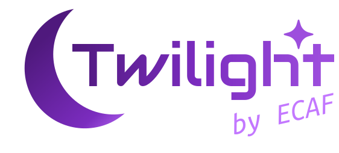

<div align="center">
	

## **Twilight by Ecaf: Backend**

</div>

--- 

## What is Twilight?

**Twilight** is a 2-week hackathon I hosted in my school.

This is the backend server used during the event by the participants to submit their projects and by organizers to track all the important information.

---

## Tech Stack

---

| Layer | Technology |
|----------|----------|
| [Frontend](https://github.com/gev-hobosyan/twilight.ecaf) | Next.js, TypeScript, TailwindCSS |
| Backend | Rust, Axum |
| Database | [Neon Lakebase](https://neon.com/lakebase), [SeaORM](https://www.sea-ql.org/SeaORM/) |
| PDF generation | [Krilla](https://github.com/LaurenzV/krilla) |
| Telegram bot | [Teloxide](https://github.com/teloxide/teloxide) |
---

## Features

- **PDF generation**: A pdf containing all the projects and participants
- **Telegram bot**: A ticket system implemented using a telegram bot
- **Voting system**: Real time voting system 

---

## Getting started

---

Make a copy of `.env.example` and name it `.env`. Replace the variables accordingly.

- `CARGO_MANIFEST_DIR`: This is the root directory of your project.
- `ADMIN_API_KEY`: The admin key used to access admin endpoints. Must be the same with the frontend. 
- `BOT_TOKEN`: Telegram bot token.
- `ADMIN_ID`: Admin's telegram ID.
- `PORT`: The port used to run the server.

The other variables are default neon variables you'll get while setting it up.

#### Starting a development server

```bash
cargo run
```

The server will be accessible on `http://localhost:PORT/`

#### Building the binary

```bash
cargo build --release && target/release/axum
```
